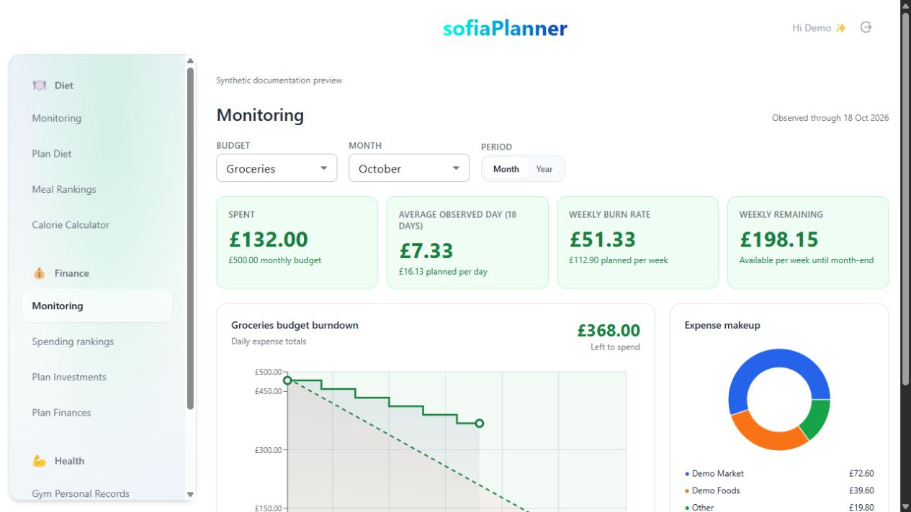
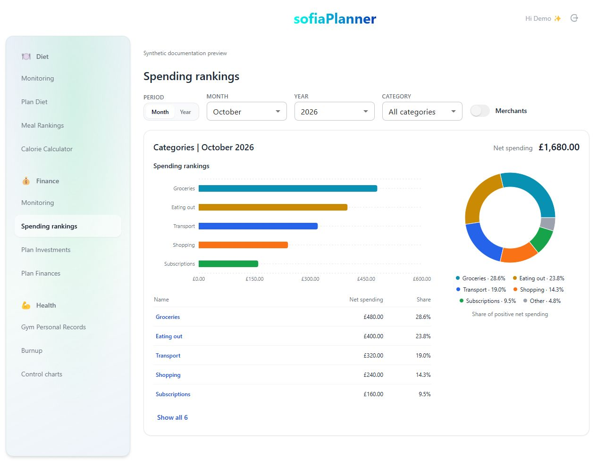
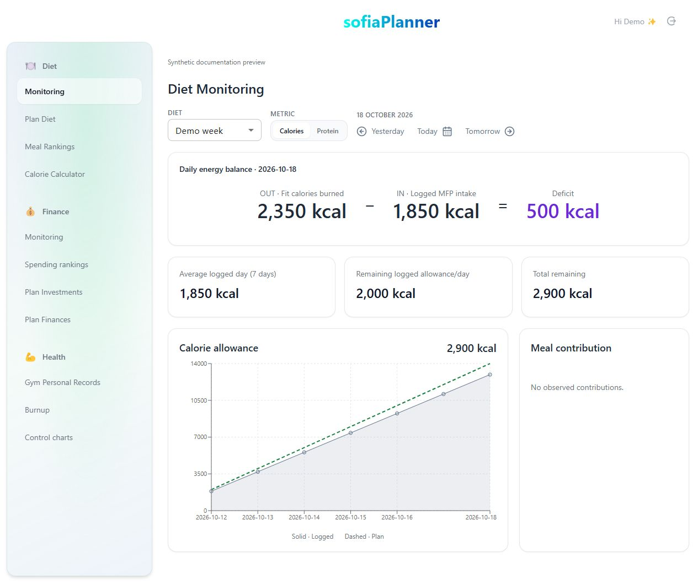
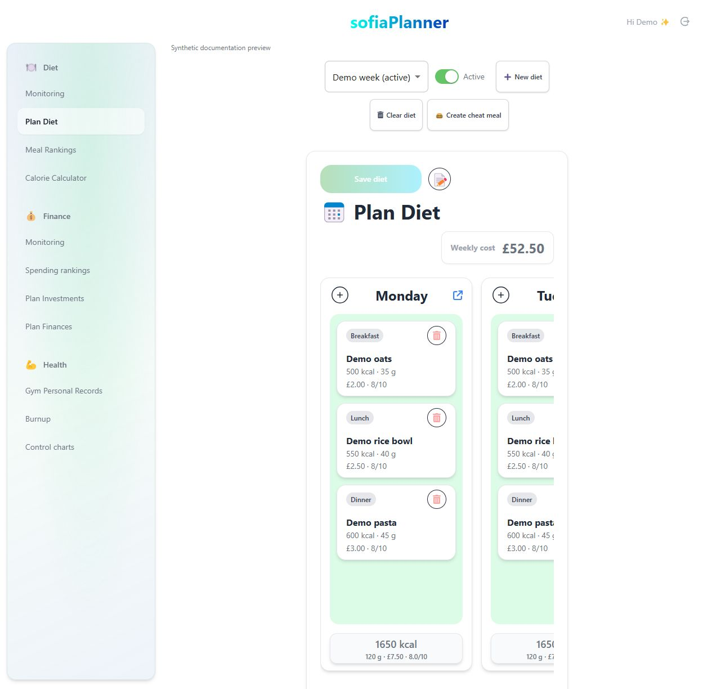
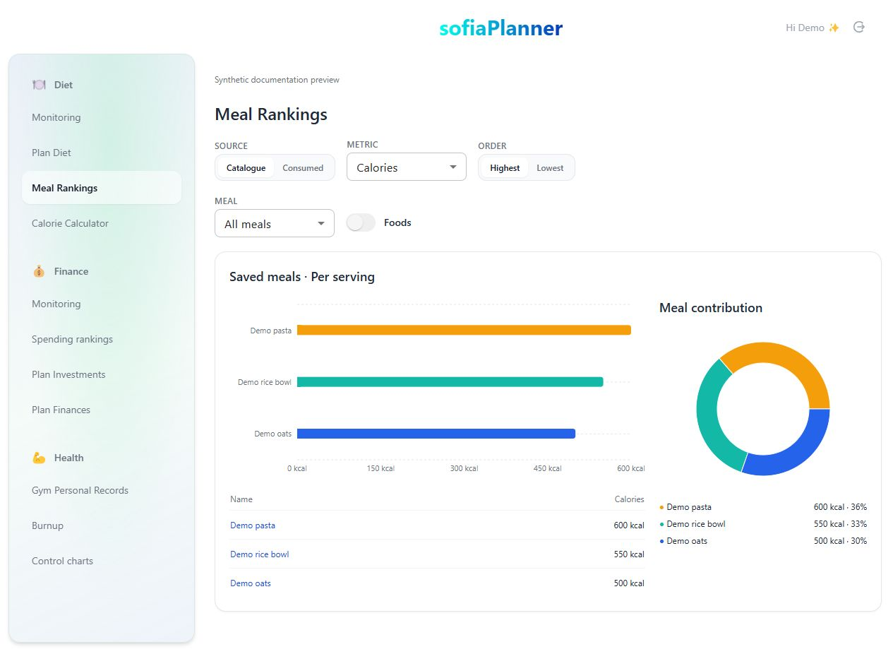
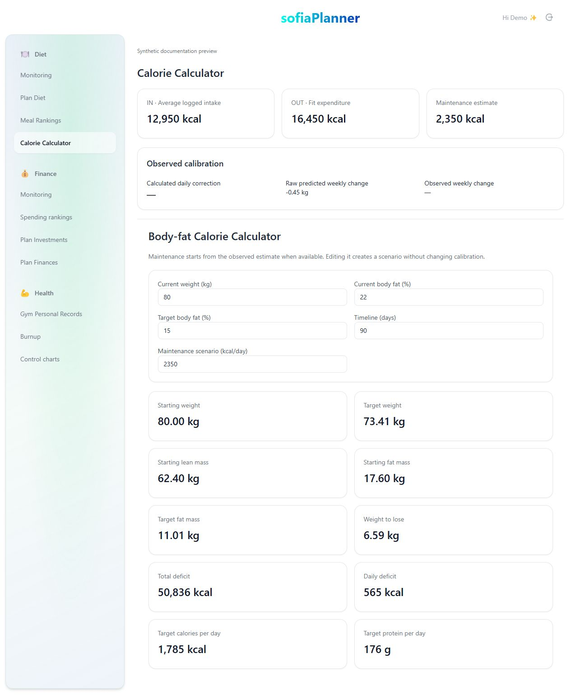
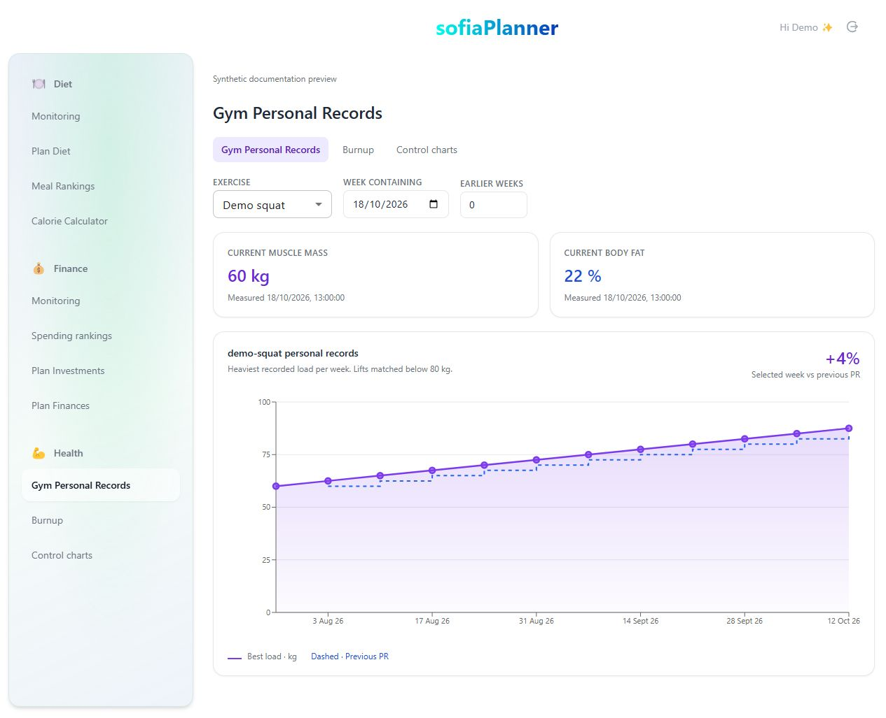
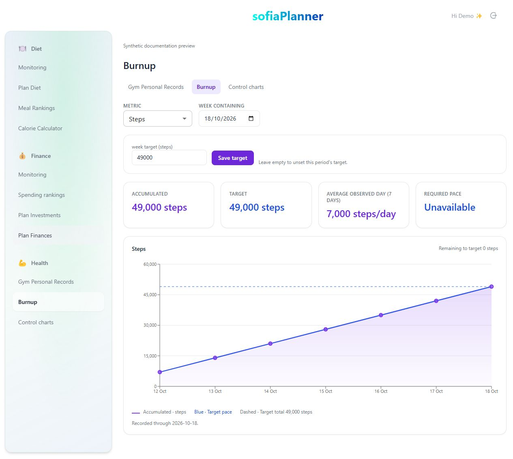
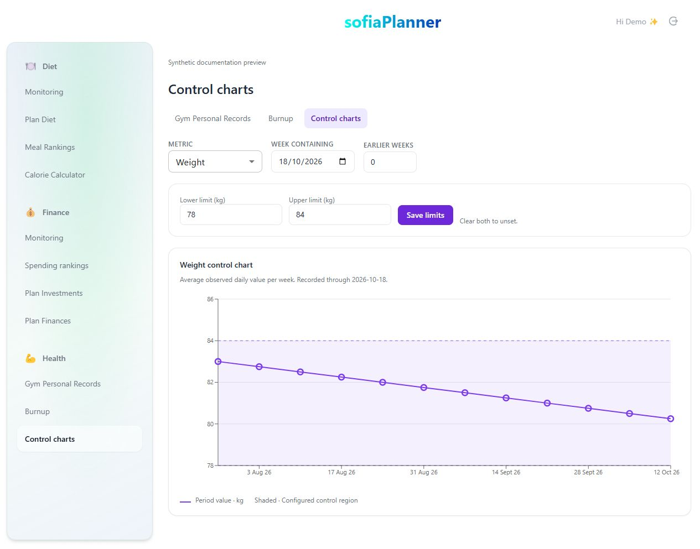

# Sofia Planner

[Open Sofia Planner](https://kesler20.github.io/sofia_planner/).

Plan meals, budgets and investments, and explore Diet, Finance and Health analytics.

## Try Sofia

The public website offers Try demo and Personal sign-in. Demo opens the real Sofia
pages with synthetic records. Changes stay in that browser and Reset demo restores
the samples. Analytics illustrate sample results rather than recomputing from demo
edits. Demo requires no account and never connects to the personal resource API.

Personal sign-in uses Google and is restricted to the configured owner. After the
first successful sign-in, that browser remembers the choice and skips the website
on subsequent visits. Google can still require authentication when a session
expires. Try demo inside the planner always opens demo, regardless of the remembered
choice. About Sofia opens the website. Signing out clears the personal preference.

Direct links append `?mode=demo`, `?mode=personal` or `?mode=landing` before the hash
route. Bookmarks can open either app directly. Private browsing starts without the
remembered preference. A mode preference grants no access to private records.

## Host your own version

Clone this repository to host a planner connected to your own accounts. The hosted
personal planner is private and does not offer visitor accounts. Its synthetic demo
is available for exploration. Do not reuse the maintainer's Auth0 application,
backend or account binding for your own deployment.

The React frontend and Express resource backend live together here. `backend/` has
its own package manifest, lockfile, environment and TypeScript scope. GitHub Pages
hosts the website and both frontend modes. Fly.io hosts the backend using the root
Dockerfile and fly.toml. Redis credentials stay on the server.

### Local development

Install frontend dependencies with `pnpm install`. Copy `.env.example` to `.env`,
provide your own public Auth0 application settings and backend URL, then run
`pnpm dev`. Demo and the website work without Auth0 configuration. Personal mode
requires the configured backend and uses the root application URL as its callback.

Inside `backend`, install dependencies with `pnpm install --frozen-lockfile`, copy
`.env.example` to `.env` and configure Redis, issuer, audience and the two owner settings.
Run `pnpm server` from `backend`. Its development command loads that directory's
local environment. Configure the frontend URL to end in `/resources`.

Frontend verification uses `pnpm type-check`, `pnpm lint` and `pnpm build`.
Backend verification uses `pnpm exec tsc --noEmit`, `pnpm test:auth` and `pnpm build`
inside `backend`. `pnpm test:storage` exercises production Redis/Lua behavior against
an isolated loopback emulator. It requires uv and makes no live database writes.

### Google sign-in and private API

Register one SPA and one API in your Auth0 tenant. Enable the Google connection,
RS256 API signing, per-application user-delegated access for that SPA, refresh-token
rotation and API offline access. No custom roles, scopes or machine-to-machine
clients are needed. The frontend uses memory token storage. The backend verifies
signature, issuer, audience, expiry and subject on every resource request, and
rejects any identity except the configured owner. Google email claims alone never
authorize access or merge identities.

`AUTH0_OWNER_SUBJECT` is the reviewed immutable Google identity allowed to sign in.
`AUTH0_OWNER_ACCOUNT_TOPIC` is the Redis namespace containing that owner's resources.
Both are private backend runtime configuration.
Existing resources retain their namespace. The backend does not migrate or copy
data. `GET /v1/account` supplies the authorized namespace for frontend cache scoping.
Resource writes use full expected values for conditional saves and show conflicts.

Configure exact callback and logout URLs for your frontend's root, including the
trailing slash. For this deployment they are
`https://kesler20.github.io/sofia_planner/` and `http://localhost:5173/`.
Allowed Web Origins and backend CORS use origins without paths, including
`https://kesler20.github.io` and `http://localhost:5173`. Preserve entries needed by
other applications in a shared tenant. Direct mode links use the same root callback.

The API audience must match `VITE_AUTH0_AUDIENCE` and backend `AUTH0_AUDIENCE` exactly.
The Pages workflow reads the public value from repository Actions variable
`AUTH0_AUDIENCE`. For this deployment it is `https://sofia-headless-backend.fly.dev/`.
Only public Auth0 domain, SPA client ID and audience belong in frontend settings.
Never put a client secret, Redis credential or owner subject in the frontend.

### Deployment

Deploy the secured backend before releasing its matching personal frontend.
Supply the backend environment through Fly secrets and deploy from this repository
with `flyctl deploy --remote-only`. The root Dockerfile builds only `backend/` and
excludes local environments. Fly starts the compiled server on all interfaces and
can stop it when idle. GitHub Pages publishes the static build under `/sofia_planner/`.
Forks should adjust the Vite base and workflow for their own repository address.
Automation Engine can continue publishing through trusted direct Redis access.

## Local prototypes

The ignored `prototypes/` folder holds local UI candidates and verification
harnesses. It is excluded from commits, pushes and deployment artifacts. Promote
approved code into maintained source. The public demo is maintained application
code and is included in deployments. Documentation screenshots live in
`docs/screenshots/`.

## Finance

Monitoring compares observed expense totals with dated targets and shows budget
burndown, burn rates and merchant composition. Rankings combine horizontal spending
bars with category or merchant composition. Select a category and use Merchants to
replace the single chart pair with its merchant breakdown.

## Diet

Monitoring shows the selected day's energy balance and weekly allowance. Plan Diet
uses the weekly meal board. Meal Rankings compares saved or consumed meals, and the
Calorie Calculator supports an unsaved body-fat scenario.

## Health

Personal Records shows eligible lift history. Burnup compares accumulated activity
with a target. Control charts compare weekly values with saved limits.

All current screenshots above show synthetic demonstration data. Earlier documentation
images are preserved in `docs/screenshots/legacy/`.
