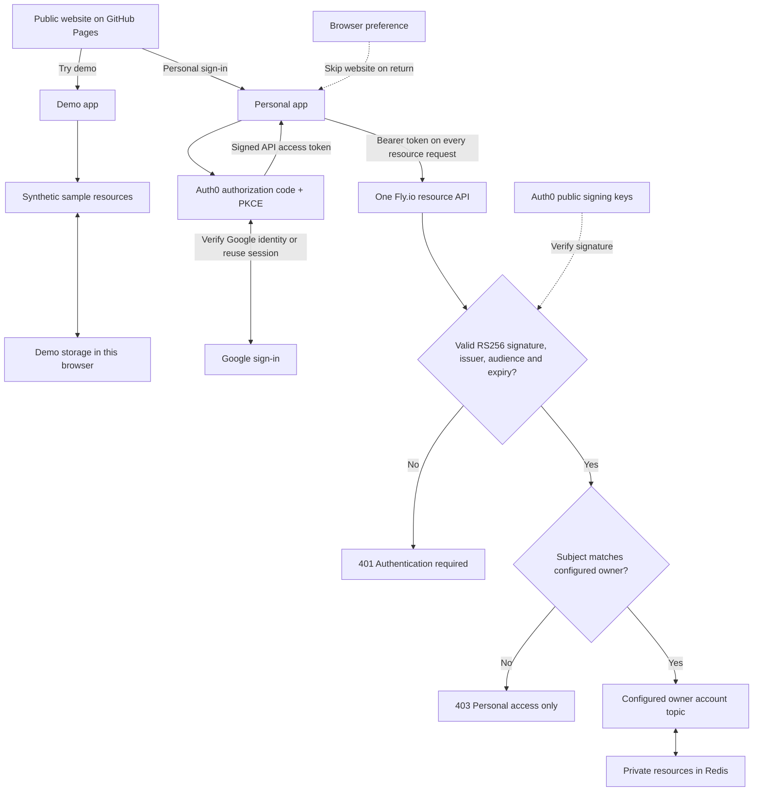
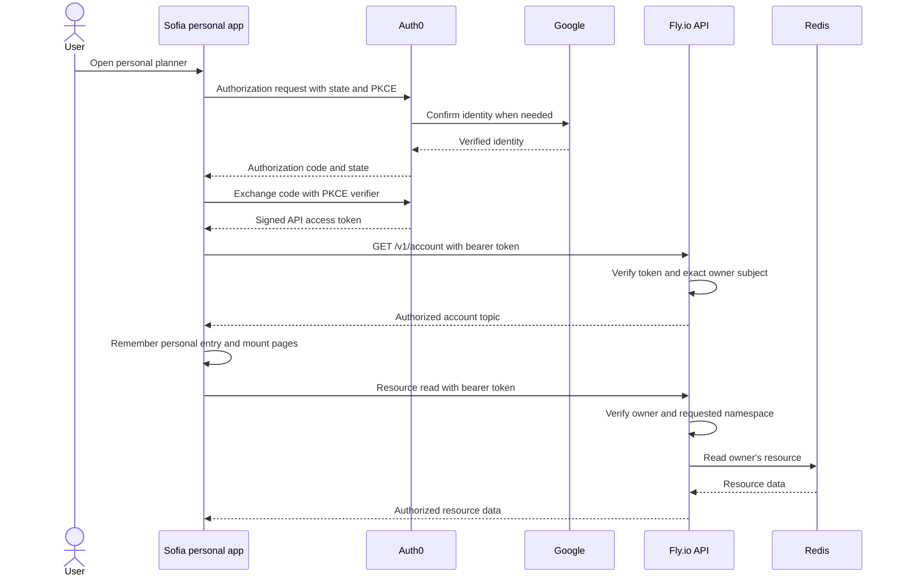

# Sofia authentication and data boundaries

The public website and demo need no sign-in. Demo installs a local resource
transport and uses synthetic data, with changes stored only in that browser.
Its requests never fall through to the personal API. Reset demo removes its
local changes. Published analytics in demo remain illustrative sample results.

The saved personal-mode preference controls navigation only. It grants no
permission to read private resources. Direct demo and website links override it.
The personal app remembers the preference only after successful API authorization.
Signing out clears it. Tokens are held in memory. Session restoration after a
reload may require Auth0 session recovery or interactive Google sign-in.

## Personal sign-in and a resource read

Auth0 issues the API access token after Google confirms the user's identity.
The backend validates the Auth0 API token, rather than trusting a Google ID token,
an email claim or a caller-selected account name. The official JWT middleware
checks the signature using Auth0's public signing keys, together with the exact
issuer, API audience, expiry and subject. The keys can be cached by the middleware.

`AUTH0_OWNER_SUBJECT` is the immutable Google-linked identity allowed to use this
private deployment. `AUTH0_OWNER_ACCOUNT_TOPIC` selects the existing Redis namespace
containing its records. These values stay in private server configuration. Unknown
subjects are rejected and no visitor account is provisioned. Explicit topic paths
must equal the resolved owner's topic, or use the current-account alias `me`.
CORS restricts browser origins but does not replace token or owner validation.

Only one Fly app and one machine host the resource backend. GitHub Pages serves
static frontend assets. The demo has no backend service. Automation Engine publishes
through trusted direct Redis access independently of browser API authentication.

## Implementation references

- [App entry and remembered mode](../src/entry/appMode.ts)
- [Auth0 provider](../src/Auth0Provider.tsx)
- [Authorized account session](../src/auth/AccountSession.tsx)
- [Bearer header and session guard](../src/auth/resourceSession.ts)
- [Demo resource transport](../src/demo/demoStorage.ts)
- [Backend token and owner verification](../backend/src/infrastructure/auth/accountAuth.ts)
- [Resource route boundaries](../backend/src/app.ts)
