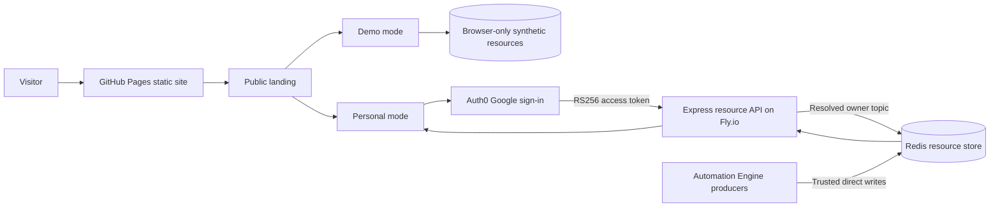
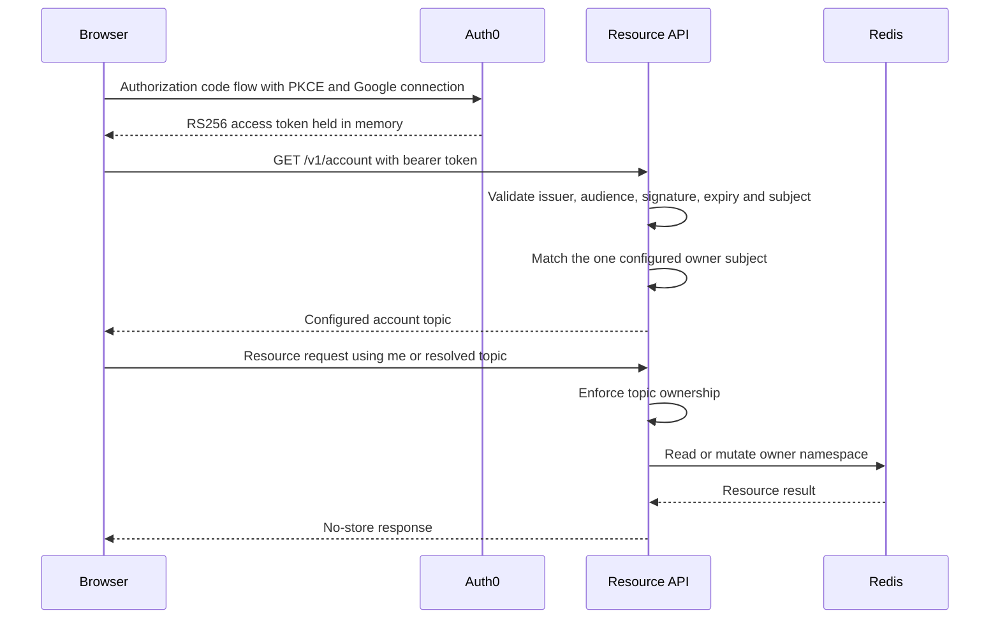

# Sofia Planner technical specification



## Purpose and scope

Sofia Planner is a single-owner personal planning application for diet, finance and health. One static frontend provides a public landing page, a synthetic demo and the authenticated personal application. A separately deployed API protects and persists personal resources. Automation Engine jobs publish analytics and actuals into the same Redis namespace through a trusted server-side path.

This specification defines the deployed boundaries, authentication, API behavior, Redis storage format, resource contracts and release process. Product intent and interaction decisions remain in the PRD, design document and decision log.

## Machine-readable contract

The following JSON is the stable deployment and persistence contract. Changes to these values or patterns require a corresponding specification update.

```json
{
  "version": 1,
  "frontend": {
    "productionUrl": "https://kesler20.github.io/sofia_planner/",
    "productionBasePath": "/sofia_planner/",
    "router": "hash",
    "modes": ["landing", "demo", "personal"],
    "demoStorageKey": "sofia/demo/resources/v1",
    "accountCachePrefix": "sofia/account/<url-encoded-account>/"
  },
  "backend": {
    "productionOrigin": "https://sofia-headless-backend.fly.dev",
    "region": "lhr",
    "runtime": "node-22-alpine",
    "authentication": "auth0-rs256-bearer",
    "ownerModel": "single-configured-subject"
  },
  "automationEngine": {
    "captureSchedule": "every-3-minutes-Europe/London",
    "executionSchedule": "every-3-minutes-Europe/London",
    "analyticsPublicationSchedule": "hourly-at-minute-0-Europe/London",
    "activeProfile": "phd"
  },
  "redis": {
    "keyPattern": "<AUTH0_OWNER_ACCOUNT_TOPIC>:<resourceName>",
    "valueType": "hash",
    "hashValueEncoding": "json-per-top-level-field",
    "emptyResourceField": "__headless_empty_resource__",
    "arrayEnvelopeField": "key"
  },
  "identifiers": {
    "effectiveTopicPattern": "^[A-Za-z0-9][A-Za-z0-9._@-]{0,253}$",
    "backendTopicPattern": "^[A-Za-z0-9][A-Za-z0-9._@+-]{0,253}$",
    "resourceNamePattern": "^[A-Za-z0-9][A-Za-z0-9._-]{0,127}$"
  }
}
```

## Runtime modes

### Public landing

The landing page is unauthenticated. It explains the product and links into the demo or personal application. It does not read or write personal resources.

### Demo

Demo mode renders the production planning pages against synthetic data held in browser storage. Its resource transport intercepts requests locally and never calls the personal API. Resetting the demo replaces the local synthetic dataset. Demo navigation preference and demo data cannot grant personal access.

### Personal

Personal mode requires Auth0 sign-in. The browser obtains an access token, asks the API for the server-resolved account topic, then scopes resource requests and local page caches to that topic. A failed account resolution leaves the personal application unavailable rather than falling back to an email-derived namespace.

## Frontend architecture

The frontend is a React 18 and TypeScript single-page application built by Vite. Material UI supplies controls, Recharts supplies charts and the existing application theme defines typography and shared presentation.

The browser selects a root mode before mounting the relevant application. Personal and demo modes use the same domain pages and a hash router. Pages own domain calculations, grouping and persistence orchestration. Shared cards, controls and chart primitives remain stateless. Resource adapters isolate remote and demo persistence from page behavior.

### Routes

| Domain | Route | Responsibility |
| --- | --- | --- |
| Diet | `/diet/monitoring` | Plan against actual diet performance |
| Diet | `/diet` | Build and activate weekly diets |
| Diet | `/diet/rankings` | Compare meals and foods |
| Diet | `/diet/calculator` | Calculate meal nutrition and cost |
| Finance | `/finance/monitoring` | Compare budget targets and actual spending |
| Finance | `/finance/rankings` | Rank spending categories and merchants |
| Finance | `/investments` | Model investment contributions and outcomes |
| Finance | `/finance` | Edit monthly budgets |
| Health | `/health/records` | Inspect health observations |
| Health | `/health/burnup` | Compare progress with targets |
| Health | `/health/control` | Inspect control limits |

Obsolete home, analytics and health-configuration routes redirect to Diet Monitoring. Obsolete meal-authoring routes redirect to Plan Diet. Obsolete finance-forecasting routes redirect to Finance Monitoring. The router preserves application navigation after a GitHub Pages fallback by using the URL fragment.

### Browser state

Remote resources remain the source of truth in personal mode. Local storage contains page preferences and account-scoped caches only. Account caches use `sofia/account/<url-encoded-account>/`. The remembered mode key `sofia/preferred-mode` controls navigation choice but has no authorization meaning.

Pages must not save defaults after a failed read. A successful hydration is read-only until an explicit user action changes a resource. When a refresh partially fails, pages may retain the last successful value for the failed resource while clearly reporting the failure.

## Authentication and authorization



The browser uses the OAuth 2.0 authorization code flow with PKCE. Google is the configured identity connection. Tokens are held in memory and refresh tokens may be used to maintain the browser session. Callback URLs use the application base in production and localhost in development, with the post-login destination kept inside the hash router.

The API accepts only bearer tokens whose Auth0 issuer, audience, RS256 signature, expiry and subject validate. It then compares the subject with `AUTH0_OWNER_SUBJECT`. Only that configured subject receives `AUTH0_OWNER_ACCOUNT_TOPIC`. Equal email addresses or caller-supplied prefixes never establish ownership. Although the API topic validator permits `+`, the current browser account validator does not. Deployed owner topics therefore use the shared subset `[A-Za-z0-9_.@-]+` until both validators are aligned.

Requests may identify the topic as `me` or as the exact resolved topic. Any other topic returns 403. CORS restricts browser origins independently of authorization. Server startup validates the authentication configuration before connecting or listening.

Public frontend configuration may include the Auth0 domain, client ID and audience. Auth0 owner bindings, Redis credentials and all secrets are server-only.

## Resource API

The production API origin is `https://sofia-headless-backend.fly.dev`. The frontend's configured resource base is `/resources` on that origin.

| Method and path | Request | Success | Purpose |
| --- | --- | --- | --- |
| `GET /v1/account` | Bearer token | `200 {"topic":"..."}` | Resolve the authenticated owner topic |
| `GET /resources/:topic` | Bearer token | `200` array of resource bodies | Read every resource in the owner namespace |
| `GET /resources/:topic/:resourceName` | Bearer token | `200` object | Read one resource |
| `POST /resources/:topic` | Resource name and JSON string | `201` | Create or replace one resource |
| `PUT /resources/:topic/:resourceName` | JSON string in `content` | `200` | Replace one resource |
| `DELETE /resources/:topic/:resourceName` | Bearer token | `200` | Delete one resource |
| `PUT /v1/resources/:topic/:resourceName` | Expected resource or null and replacement | `200 {"applied":true}` | Atomic compare-and-swap |

Every API response uses `Cache-Control: no-store`. Invalid identifiers or payloads return 400. A missing single-resource read returns 404. Deleting an absent resource is idempotent and returns success. An authentication failure returns 401 and a mismatched owner returns 403. A stale conditional write returns 409. Oversized JSON returns 413. Unexpected failures return a generic 500 response without leaking claims, payloads, credentials or provider details.

Conditional writes compare the complete decoded expected resource with the stored value. A match replaces the full resource atomically. A mismatch makes no change. Diet plans, diet notes and cheat meals use this contract to prevent silent lost updates. Client-side browser locks serialize edits from the same browser, while compare-and-swap protects against concurrent writers across sessions.

## Redis namespace and physical schema

Each logical resource is one Redis hash at:

```text
<AUTH0_OWNER_ACCOUNT_TOPIC>:<resourceName>
```

The API never trusts the topic from the URL when choosing this prefix. It uses the topic resolved from the authenticated owner configuration.

Each top-level JSON property becomes a Redis hash field. The field value is that property's JSON encoding. For example:

```json
{
  "schema_version": 1,
  "entries": [{"id": "example"}]
}
```

is stored conceptually as:

| Redis hash field | Redis hash value |
| --- | --- |
| `schema_version` | `1` |
| `entries` | `[{"id":"example"}]` |

A top-level array is transported and stored as `{ "key": [...] }`. The frontend unwraps this compatibility envelope on reads and applies it on writes. An empty object is represented internally by the sole field `__headless_empty_resource__` with value `1`. The API strips that marker on reads and rejects it in public payloads.

API replacement and successful compare-and-swap delete the previous hash and write the complete replacement in one atomic Redis operation. Automation Engine direct non-empty writes merge supplied top-level fields into the existing hash, while its empty write replaces the hash with the internal empty marker. Producer payloads must therefore overwrite every field they own and must not rely on omitted fields being deleted. The collection read scans keys under the authenticated topic prefix and returns decoded resource bodies without their resource names.

## Logical resources

### User-owned planning resources

| Resource | Shape | Writer | Notes |
| --- | --- | --- | --- |
| `diets` | Array envelope of diet plans | Personal UI | Named weekly plans, active flag, optional finalization time and note |
| `meals` | Array envelope of meal definitions | Trusted producer or compatible client | Catalogue used by diet planning |
| `foods` | Array envelope of food definitions | Trusted producer or compatible client | Ingredient catalogue retained for planning integrations |
| `cheat_meals` | Versioned object with entries | Personal UI | Authored exceptions with stable UUID and positive revision |
| `monthlyBalance` | Object keyed by English month | Personal UI | Income and expense categories with named sections |
| `monthly_fixed_investment` | Number array | Personal UI | First value is the current monthly contribution |
| `investment_params` | Projection parameters | Personal UI | Principal, contribution, years, inflation and dividend assumptions |
| `diet_config` | Versioned scoring rules | Personal UI | Correction factor plus weighted direction for each diet measure |
| `health_config` | Versioned targets and limits | Personal UI | Per-metric weekly, monthly or yearly settings |

### Producer-owned analytics resources

These resources are read-only in normal page flows. Automation Engine or another trusted producer publishes them.

| Resource | Consumer |
| --- | --- |
| `diet_actuals` | Diet monitoring |
| `diet_analytics` | Diet monitoring and rankings |
| `health_analytics` | Health records, burnup, control and diet context |
| `finance_expense_actuals` | Finance monitoring |
| `finance_monitoring` | Finance monitoring |
| `finance_spending_rankings` | Finance rankings |

### Producer contract summaries

| Resource | Version and identity | Observation and freshness | Representative payload |
| --- | --- | --- | --- |
| `diet_actuals` | `schema_version: 1`, string `revision` | Offset timestamp `captured_at`, unique London dates and explicit daily `complete` | Days contain unique entries with nullable meal identity, positive servings, non-negative calories and protein, nullable non-negative GBP cost and optional observed foods |
| `diet_analytics` | `schema_version: 1`, string `revision`, `input_revisions` | `generated_at`, London `as_of`, observed-day counts and partial flags | Per-diet calories and protein monitoring, dated points, catalogue and consumed rankings, daily balance and seven-day calibration |
| `health_analytics` | `schema_version: 1`, string `revision` | `generated_at`, per-source `observed_through`, period-level partial state | Metric catalogue, daily values and muscle volumes, exercise bests, weekly controls, records, burnup series, latest body values and unmapped exercises |
| `finance_expense_actuals` | `schema_version: 1`, string `revision` | Boolean `available`, nullable `captured_at` and `observed_through`, inclusive coverage ranges | Entity catalogue and dated rows with entity ID, finite signed value and nullable merchant |
| `finance_monitoring` | `schema_version: 1`, string `revision`, `input_revision` | `generated_at`, London `as_of`, observed days, partial and complete states | Per-category twelve-month and yearly views with points, budget, spent, remaining, rates and merchant breakdown |
| `finance_spending_rankings` | `schema_version: 2`, string `revision`, `input_revision` | Boolean `available`, nullable `captured_at` and `observed_through`, inclusive observed coverage | Monthly and yearly periods with complete or partial coverage, safe-integer net totals, category and merchant rankings and bounded shares |

Date fields use `YYYY-MM-DD` where described as London dates. Missing observations remain null or unavailable. They are not converted to zero. Producer snapshots publish revision and freshness evidence together so consumers can display stale or partial data without inventing coverage.

### Retained integration resources

The broader product data model also defines `finance_category_targets`, `finance_shopping_actuals`, `finance_forecasts`, `sofia_config` and `sofia_monitoring` for Automation Engine integrations. `finance_category_targets` is the authoritative monitoring-target input published from the canonical finance note. The others are producer contracts consumed where the corresponding product flow is active.

## Core JSON contracts

Types shown with `?` are optional. `null` is meaningful where explicitly shown and is not interchangeable with a missing field.

### Diet planning

```text
Food = {
  catalogueId?: string,
  name: string,
  servingUnit?: string,
  calories: number | null,
  protein: number | null,
  carbs: number | null,
  fat: number | null,
  cost: number | null,
  vendor: string | null,
  amount: number | null,
  quantity?: non-negative number,
  tasteScore?: number from 1 to 10 | null,
  convenienceScore?: number from 1 to 10 | null,
  ...compatible extension fields
}

Meal = {
  catalogueId?: string,
  name: string,
  foods: Food[],
  tasteScore: number from 1 to 10 | null,
  convenienceScore?: number from 1 to 10 | null,
  ...compatible extension fields
}

Diet = {
  name: string,
  active: boolean,
  finalizedAt: string | null,
  note?: string,
  meals: {
    Monday: Meal[], Tuesday: Meal[], Wednesday: Meal[],
    Thursday: Meal[], Friday: Meal[], Saturday: Meal[], Sunday: Meal[]
  }
}
```

`cheat_meals` has `schema_version: 1` and unique entries containing a UUID `id`, a positive integer `revision`, an input food snapshot, `created_at` and `updated_at`. A producer projection may enrich only the exact authored revision it read.

`diet_config` has `schema_version: 1`, a finite correction value and rules for calories, protein, cost, taste and convenience. Every rule has a finite non-negative weight and a direction of `minimise` or `maximise`.

### Finance planning

```text
monthlyBalance = {
  January..December: {
    categories: [{
      name: string,
      type: "income" | "expense",
      sections: [{name: string, value: number}],
      isVariable?: boolean,
      variableId?: string
    }]
  }
}

investment_params = {
  principal: finite number,
  monthlyContribution: finite number,
  years: finite number,
  inflationRate: finite number,
  dividendYield: finite number,
  ...compatible extension fields
}
```

The investment page calculates monthly net budget from `monthlyBalance`. If confirmed budget data is unavailable, it reports the failure and does not present illustrative values as actual availability.

### Health configuration

```text
health_config = {
  schema_version: 1,
  targets: {
    "<metric-id>": {
      week?: non-negative number,
      month?: non-negative number,
      year?: non-negative number
    }
  },
  limits: {
    "<metric-id>": {
      week?: {lower: number, upper: number},
      month?: {lower: number, upper: number},
      year?: {lower: number, upper: number}
    }
  }
}
```

Every health limit requires `lower < upper`. The current health UI primarily edits weekly settings but preserves valid monthly and yearly settings written by earlier or external clients.

## Responsibility boundaries

The personal UI owns explicit plan and configuration edits. Automation Engine owns captured actuals, forecasts and analytics. The API owns authentication, account resolution, validation of storage identifiers and atomic persistence. Redis provides storage but does not define business meaning.

Calculations that explain the current view remain in the frontend, including diet totals, budget totals and investment projections. Producer-derived analytics remain producer-owned. A page must label missing or stale producer data rather than manufacturing authoritative-looking actuals.

### Diet Monitoring presentation

- The selected London day's equation is logged MFP intake minus the parenthesised
  sum of estimated Fit maintenance and Fit exercise plus steps. The burn terms
  retain their producer attribution and sum to total Fit expenditure.
- Intake renders red and burn green. The displayed result negates the producer's
  burn-minus-intake balance. Positive surplus is red, negative deficit green and
  zero balanced neutral grey. Missing balance remains unavailable.
- Calorie tooltips retain weekly allowance remaining and plan and add the hovered
  date's logged calorie intake and total Fit expenditure. Protein tooltips retain
  cumulative protein and plan and add that date's logged protein intake.
- Daily intake sums that date's recorded diary entries, including an unfinished
  logged day. Explicitly completed empty days yield zero. Unconfirmed empty days
  remain unavailable. Total expenditure uses that date's published daily balance.
- Hover values stop at the selected date and today. Future and missing values
  remain unavailable without changing the cumulative chart series.

### Automation schedules

On the PhD capture profile, Automation Engine ingestion and execution workflows run every three minutes in the Europe/London timezone. Ingestion captures source changes but does not publish Planner analytics. The analytics workflow is the sole warehouse builder and Planner publisher. It runs hourly at minute zero in the same timezone. This separation prevents capture and publication writers from racing each other.

## Deployment and release

### Frontend

Pushes to `main` trigger GitHub Actions. The workflow installs dependencies, type-checks, lints and builds the application. Production builds use `/sofia_planner/` as the base path and the Fly resource endpoint as the backend. The workflow copies the built entry page to `404.html` so GitHub Pages can recover application URLs, then deploys the static artifact.

The production workflow requires the Auth0 API audience as a GitHub Actions variable. Public Auth0 client configuration may be supplied as build variables. Secrets must not enter the static bundle.

### Backend

The backend is built independently into one Node server bundle and deployed explicitly to the Fly application `sofia-headless-backend` in London. It runs on a shared CPU machine with 256 MB memory, exposes HTTPS to internal port 3000 and may scale to zero. Deployment uses `flyctl deploy --remote-only` from the repository root so the root Dockerfile can copy the backend build context.

Redis connection details, Auth0 issuer and audience, the one owner subject, the owner topic and allowed origins are Fly secrets or server environment values. Backend deployment is not part of the frontend GitHub Pages workflow.

## Failure and recovery behavior

- A personal authentication or account-resolution failure blocks resource access and offers an explicit retry.
- A resource read failure does not trigger a default write.
- Missing optional configuration may initialize an in-memory default, but persistence requires an explicit save.
- A 409 conditional-write response tells the user to refresh before saving again.
- A post-save verification mismatch is treated as a failed save.
- Producer resources can fail independently. Successful resources remain usable and failed sections show their own state.
- Demo data can be recovered by resetting the synthetic browser dataset.
- Personal data recovery depends on Redis. No backup provider, retention period or tested restore procedure is established in this repository. The browser cache is not a backup.

## Security and privacy requirements

- Only the configured Auth0 subject may access the personal deployment.
- The API determines the Redis topic. The browser cannot claim another topic.
- Access tokens stay in memory and are sent only as bearer credentials to the configured API.
- All production traffic uses HTTPS.
- CORS origins are explicit and do not substitute for authorization.
- Responses carrying account or resource data are not cacheable by shared intermediaries.
- Error responses and logs omit bearer tokens, resource bodies, identity claims and provider details.
- Demo resources remain local and contain synthetic data only.
- The static bundle contains no Redis credential, owner subject or other server secret.

## Verification contract

A release is acceptable when:

1. Frontend type-check, lint and production build succeed.
2. Backend type-check, authentication tests, storage tests and production build succeed.
3. The public landing loads at the GitHub Pages URL.
4. Demo mode performs reads, writes and reset without a network call to the personal API.
5. Personal sign-in resolves the configured account topic and rejects an unknown Auth0 subject.
6. A resource round trip preserves objects, top-level arrays and empty objects.
7. A stale compare-and-swap write returns 409 without changing Redis.
8. GitHub Pages deep-link recovery returns the application shell.

The production acceptance check uses synthetic or non-sensitive fixtures. It must not expose access tokens, Redis credentials or personal resource contents in logs or screenshots.
